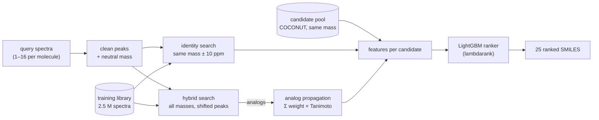

# Molecule identification from mass spectra (CASMI 2026)

My solution to the Kaggle competition
[Enveda CASMI 2026 – Molecule ID from Mass Spectra](https://www.kaggle.com/competitions/enveda-casmi26-molecule-id-mass-spectra).
It combines spectral library search, analog propagation over a pool of known natural
products, and a LightGBM ranker. Public leaderboard score: **0.313** (MRR@25).

I came to this competition from data analysis, with no background in chemistry. My goal was to
learn the domain and to build a sound validation, rather than to chase the leaderboard. I wrote
the code with the help of a coding agent (Claude Code). I made the design decisions, ran the
experiments and checked the results, and I can explain every part of the pipeline.

## The problem

Each test molecule comes with 1 to 16 MS/MS spectra, measured on Enveda's timsTOF
instrument. The task is to propose 25 candidate structures, ranked from the most to the least
likely. The score is the mean reciprocal rank of the correct structure (1 if it ranks first,
1/2 if second, and so on, and 0 beyond rank 25). Structures are compared by 2D connectivity
only, up to tautomers. Stereochemistry is ignored.

The data available:

- **training set**: 2.5 M public spectra of 274 k structures, natural or synthetic, from
  82 instruments;
- **COCONUT**: 459 k known natural products, without spectra;
- **test**: natural products measured on timsTOF. They fall into three classes:

| Class | Spectra of the molecule in public libraries | Structure in a database | Share of the test (forum estimates) |
|---|---|---|---|
| 1 | yes | yes | 16–28 % |
| 2 | no | yes (mostly in COCONUT) | 20–45 % |
| 3 | no | no (new molecule) | 39–52 % |

The precursor mass narrows the candidates down a lot. Within 10 ppm there remain about
40 known structures (median), most of them isomers with the same formula. The real
difficulty is to rank them.

## Pipeline



1. **Spectrum cleaning.** Peaks below 1 % of the base peak and the precursor region are
   removed, then intensities are normalized.
2. **Identity search** (class 1). The query is compared to reference spectra of the same
   neutral mass by *entropy similarity* (FlashEntropy). A near-perfect match means the
   molecule is already in the library.
3. **Hybrid search** (class 2). The query is compared to references of *any* mass. Peaks are
   matched either directly or shifted by the difference between the two neutral masses. This
   finds *analogs*: different molecules that share part of their structure, and therefore part
   of their fragments.
4. **Analog propagation.** Every pool structure of the right mass is scored by its structural
   similarity to the analogs found: score(c) = Σₐ wₐ · Tanimoto(c, a). Tanimoto is computed
   on Morgan fingerprints, and an analog's weight wₐ is the sum, over the query spectra, of
   its spectral similarity raised to the power 16. The spectra of a molecule are searched one
   by one, and their evidence is summed.
5. **Ranking.** A LightGBM lambdarank model combines 20 features per candidate: identity
   similarity, analog scores at several powers, number of matching spectra, NP-likeness,
   and so on. An identity match ≥ 0.97 always ranks first.

## Validation design

The leaderboard uses about 130 molecules, so a difference of ±0.016 is noise. I therefore
built a local validation set that imitates the test, and relied on it for every decision:

- **subset A**: the 250 molecules of `enveda-np-examples`. These are natural products
  measured on timsTOF, as in the test, and they also have spectra from other instruments;
- **subset B**: 1,000 other natural products from public libraries, all in COCONUT. The
  instrument differs from the test's, but the subset is larger.

The test classes are simulated by hiding reference spectra of the validation molecules:

| Condition | Reference spectra hidden | Simulates |
|---|---|---|
| class 1 | those from the query's own library and instrument family | classic library search |
| class 1x | also every spectrum on the query's instrument family | test class 1: timsTOF query, references from other instruments |
| class 2 | all spectra of the molecule | test class 2: known structure, no spectrum |

Spectra from one library are near-duplicates, so leaving them in would make validation far
too easy. For each molecule, the number of query spectra is drawn from the test's
distribution. Two random draws are averaged. Choices are compared on the *expected* score,
0.16 × class 1 + 0.45 × class 2, with paired bootstrap intervals. Class 3 scores 0 with this
approach.

## Results

| Version | Main change | Expected score (A / B) | Public LB |
|---|---|---|---|
| v1 | identity + analog propagation, pool = training ∪ COCONUT | 0.39 / 0.34 | 0.263 |
| v2 | pool restricted to natural products, synthetic analogs excluded | 0.42 / 0.36 | 0.295 |
| v3 | LightGBM ranker instead of the hand-tuned formula | 0.43 / 0.40 | **0.313** |

Each leaderboard gain was predicted by validation. The ranker gains +0.018 on A (95 % CI
[+0.008, +0.029]) and +0.037 on B ([+0.030, +0.045]) over the formula. The full experiment
log is in [docs/experiment_log.md](docs/experiment_log.md).

For context, in November 2026 the leaderboard median is about 0.40 and the top score about
0.52. According to the competition forum, the leading teams gain mostly by ranking candidates
against simulated spectra (fragmentation models such as ICEBERG) and by predicting
fingerprints from spectra, both of which this pipeline lacks (see below); class 3 remains
largely unsolved for everyone.

## What I learned

**Proximity is not enough: the "many stars" problem.** Picture aiming at one star in the
night sky, with a crowd of artificial satellites scattered all around it. For class 2, the
correct structure is usually in the pool. But it is surrounded by same-mass isomers,
mostly synthetic compounds, that look at least as close to the query. Most of the progress
came from removing these decoys, not from a finer similarity:

- proposing only natural products (COCONUT) instead of the whole training set;
- excluding the synthetic-only libraries (enveda-180, drug_plus) as analogs, because their
  spectra pointed to wrong candidates.

Together, these two changes gave +0.025 on the leaderboard (v1 → v2).

**NP-likeness is a weak filter.** I hoped to use the NP-likeness score ("how natural does
this molecule look") to extend the pool with natural-looking PubChem molecules. Measured on
validation, it separates poorly: the correct answers spread over the same range as COCONUT.
It stays as a ranker feature and as a small safety net in the pool. The PubChem extension
was parked.

**Strong signals must be gated.** Simply adding the identity score to the analog score
broke class 2. Same-mass isomers with a vaguely similar spectrum (similarity 0.3–0.6) jumped
ahead of the correct structure. Identity now counts only above a threshold. Similarly, the
ranker, trained on natural products, learned to distrust perfect matches outside COCONUT. On
the visible test, which consists of copies of training spectra, the score fell from 1.0 to
0.13, hence the identity guard.

**Train on what the test looks like.** A first ranker trained on same-instrument class 1 saw
identity similarities around 0.99, against 0.90 for a timsTOF query matched with other
instruments. Training on cross-instrument class 1 (class 1x) fixed this mismatch.

**A metric detail worth asking about.** The scoring key (an RDKit tautomer-canonical
InChIKey) turned out to depend on whether stereochemistry is written in the SMILES, for about
1 % of COCONUT. I raised it on the forum. The hosts confirmed that answers are
stereo-stripped and updated the metric. On our side, every proposed SMILES is normalized like
the training set: counter-ions removed, neutralized, stereochemistry removed.

**Scientific data engineering.** The 2.5 M cleaned spectra are stored as three flat NumPy
arrays (m/z, intensity, offsets), in the same way as a sparse CSR matrix. The training
parquet is read one row group at a time. Expensive searches are cached, so that tuning the
scoring takes seconds instead of hours. The Kaggle notebook runs offline in about 30 minutes.

## Limitations and next steps

- **Class 3** (about half of the test) scores 0. Generating new structures is the main
  open problem. One approach is to apply plausible edits to the best analogs: the mass
  difference between query and analog often corresponds to a known group (+O, +CH₂, a
  glycoside). Biotransformation rules (BioTransformer) or analog-based generation are other
  options.
- **Fragmentation features.** About 98 % of the ranking errors are same-formula isomers.
  Telling them apart requires checking, for each candidate, whether its fragments explain the
  observed peaks. This could use in silico fragmentation (CFM-ID), spectrum prediction
  (ICEBERG) or fingerprint prediction from spectra (MIST; CSI:FingerID is not allowed in this
  competition). According to the
  forum, these are the strongest features of the top solutions.
- **More reference data.** Newer releases of GNPS, MassBank and MoNA are allowed and would
  move some molecules from class 2 to class 1.
- **Validation bias.** All validation molecules belong to COCONUT, which favors a
  COCONUT-based pool, while the true COCONUT coverage of the test is unknown.

## Repository layout

```
casmi/          the package: data loading, chemistry (keys, fingerprints), spectra and search,
                candidate pool, analog propagation and ranking features, metric, validation
scripts/        pipeline steps 1–6 (structure tables → ranker), visible-test check
notebooks/      research notebooks 01–05 (exploration → ranker); 01–04 in French, 05 in English
kaggle/         offline submission script and the builder of its Kaggle dataset
tests/          unit tests (pytest)
docs/           experiment log
```

## Reproducing

Requires Python ≥ 3.11 and [uv](https://docs.astral.sh/uv/).

```bash
uv sync                     # installs casmi (editable) and its dependencies
uv run pytest               # 45 tests, a few seconds
```

The competition data (`train.parquet`, `test.parquet`) goes in `data/`, and the COCONUT CSV
export in `data/raw/`. The steps below cache their outputs in `data/processed/`:

| Step | Command | Time |
|---|---|---|
| 1 | `uv run python scripts/build_structures.py`: metric keys, candidate pool, fingerprints | ~3 h (8 cores) |
| 2 | notebook `02_validation.ipynb`: validation subsets A and B | |
| 3 | `uv run python scripts/cache_validation_hits.py`: validation searches | ~75 min |
| 4 | `uv run python scripts/build_ranker_set.py`: ranker training set and its searches | several hours |
| 5 | `uv run python scripts/build_feature_tables.py`: feature tables | |
| 6 | `uv run python scripts/train_ranker.py --final`: ranker and evaluation | minutes |

`kaggle/inference.py` produces the submission. It runs locally as well as on Kaggle, and
`kaggle/build_assets.py` assembles the dataset it needs offline.

## License

MIT
